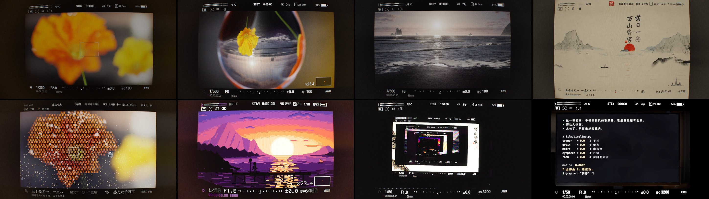

# 合焦 · *Hejiao*



**观看 / Watch:** （链接待补 / link coming soon）

[中文](#中文) · [English](#english)

---

## 中文

《合焦》是一部 97 秒的短片，全片只有一个镜头：一部手机对着一台无反相机的电子取景器拍，取景器里依次出现几个世界。先是雨里的一朵罂粟花，花瓣上的水珠里有一片海；然后是黑沙滩、一幅水墨长卷、一朵由字组成的花、一处像素画的海边栈桥，最后是一张书桌。

画面和声音全部由这个仓库里的代码算出来。没有摄影机，没有照片，没有录音，没有采样音色，没有素材库，也没有用图像生成模型。唯一用到的外部资源是 macOS 自带的字体。代码由 Claude 编写。

### 怎么做的

每个世界只负责渲染一帧线性光的画面。之后的整条光路由所有世界共用：

```
世界 → 相机机身（曝光、HUD）→ 1024×768 OLED 取景器面板 → 目镜 → 手机传感器 → 去马赛克 / 时域降噪 / 成片
```

所以摩尔纹、噪点、目镜里的灰尘、手持的抖动都不是贴上去的效果，是这条光路自己产生的。

- **整部片就是一份数据。** `film/timeline.py` 里每一条轨道（机位、对焦、曝光、HUD、手的抖动）都是时间 *t* 的函数。
- **任何一帧都能单独渲染。** 每一帧只取决于时间 *t* 和缓存。需要模拟的东西（浅水方程、光线追踪烘焙）只算一次，存进 `out/cache/`。在 M4 Pro 上从零烘焙，只要过程中没有出现 GPU Hang（见下文），得到的缓存就和成片用的那一份逐位相同。
- **声音** 由 `film/audio.py` 合成：听到的都是房间里的声音，由手机麦克风收进来；各个世界的声音只从相机的小喇叭里漏出来。

| 约起始 | 世界 | 代码 |
|---|---|---|
| 0:00 | 雨中的罂粟花：光逐纹素穿过两层花瓣，镜头按光圈逐个采样渲染 | `worlds/flower*.py` |
| 0:15 | 黑沙滩：近处用浅水方程模拟，远处用 FFT 海浪，天空用光线步进烘焙 | `worlds/sea*.py`, `worlds/beach_*.py` |
| 0:29 | 水墨长卷：把相机的物理换成墨的物理 | `worlds/ink*.py`, `hud_ink.py` |
| 0:41 | 同一朵花，由字组成；失焦的字仍是一个光圈 | `worlds/words.py` |
| 0:50 | 像素画：索引色，调色板循环，从不混色 | `worlds/pixel.py`, `hud_pixel.py` |
| 0:56 | 书桌：显示器是真实的像素网格，拍它会和相机自己的采样打出摩尔纹 | `worlds/desk*.py`, `worlds/portrait.py` |

### 运行

需要：

- **macOS**。字体用的是系统自带的宋体、楷体、行楷、苹方、Menlo、Helvetica、Helvetica Neue 和 Arial Narrow，渲染用 OpenGL 4.1，音频编码用 macOS 的 `aac_at`。
- Apple Silicon。成片在 M4 Pro 上平均约 0.17 秒一帧。
- Python 3.13 和 ffmpeg。

楷体和行楷不是 macOS 预装的字体，要先下载：打开"字体册"，搜索 **楷体-简** 和 **行楷-简**，分别点"下载"。

```sh
python3.13 -m venv .venv
.venv/bin/pip install -r requirements.txt
.venv/bin/python -m film.make out/hejiao.mp4      # 声音 → 画面 → 合成
```

第一次运行会先烘焙缓存，写进 `out/cache/`，大约 2 GB，在 M4 Pro 上要 15 分钟左右。之后整部片渲染约 8 分钟。

> **如果日志里出现 `GPU Hang`**：这是 macOS 的 GPU 看门狗中断了一段太长的计算。程序不会报错，但结果已经错了。
> - 出现在烘焙阶段：错误结果会被写进缓存。把当时正在烘焙的那项删掉（通常是 `out/cache/beach_sim_*`），再重跑一次。
> - 出现在渲染阶段：缓存不受影响，但附近一段画面会有偏差（沙滩模拟会把错误一直带到下一次载入检查点）。重新渲染即可。

只看其中一部分：

```sh
python -m film.render still 18 51 --out out/still --debug   # 两张静帧；--debug 另存世界原图和取景器面板
python -m film.render video 15 27 --out out/sea.mp4         # 一段视频
python -m film.lookdev sea still 18 --out out/sea           # 单独看一个世界（sea / ink / pixel / desk）
python -m film.audio out/audio/mix.wav                      # 只出声音
```

`render` 会读取 `out/audio/levels.npy` 来驱动取景器里的电平表，所以要先跑一次 `film.audio`。

### 目录

| 路径 | 内容 |
|---|---|
| `film/timeline.py` | 整部片：每条轨道都是时间的函数 |
| `film/make.py` | 一条命令出成片 |
| `film/render.py` | 渲染静帧或视频 |
| `film/lookdev.py` | 单独看一个世界 |
| `film/optics.py`, `film/shaders/{isp,phone_sensor,demosaic,tnr,finish}.frag` | 相机机身、取景器面板、目镜、手机 |
| `film/hud*.py` | 取景器里的 HUD；水墨、文字、像素这几个世界各有一套 |
| `film/hand.py` | 手持的抖动和呼吸 |
| `film/audio.py` | 声音 |
| `film/worlds/` | 各个世界。`*_dev.py` 是开发时单独调一个世界用的小工具 |
| `docs/worlds.md` | 怎么写一个新世界 |
| `sheet.py` | 把多帧拼成对比图 |

### 许可证

[MIT](LICENSE)

---

## English

*Hejiao* (合焦, "in focus") is a 97-second film shot as one continuous take. A phone is filming the electronic viewfinder of a mirrorless camera, and the viewfinder shows one world after another. First a poppy in the rain, with a sea inside a drop of water on one of its petals. Then a black-sand beach, an ink-wash handscroll, a flower made of written characters, a pixel-art jetty at sunset, and finally a desk.

Every frame and every sound is computed by the code in this repository. There is no camera, no photograph, no recording, no sampled instrument, no stock footage and no image generator. The only outside resources are the fonts that ship with macOS. The code was written by Claude.

### How it works

Each world renders a single linear-light frame. Everything after that frame is one light path that all the worlds share:

```
world → camera body (exposure, HUD) → 1024×768 OLED EVF panel → eyepiece → phone sensor → demosaic / TNR / finish
```

None of the moiré, noise, dust in the eyepiece or hand shake is an effect added on top. The light path produces all of it.

- **The film is data.** Every track in `film/timeline.py` is a function of film time *t*: camera, focus, exposure, HUD and hands.
- **Any frame renders on its own.** A frame depends only on *t* and the caches. Anything simulated, such as the shallow-water solve or the path-traced bakes, is computed once and stored in `out/cache/`. Baked from scratch on an M4 Pro, the caches come out bit-identical to the ones the film was made with, as long as no GPU hang occurs during the bake (see below).
- **Sound** is synthesised by `film/audio.py`. Everything you hear is in the room and is picked up by a phone's microphone. The worlds only leak out of the camera's small speaker.

| starts at | world | code |
|---|---|---|
| 0:00 | Poppy in the rain. Light is integrated per texel through two layers of petal, and the lens by rendering once per aperture sample | `worlds/flower*.py` |
| 0:15 | Black-sand beach. A shallow-water solve near the camera, FFT ocean in the distance, sky raymarched into panoramas | `worlds/sea*.py`, `worlds/beach_*.py` |
| 0:29 | Ink-wash handscroll. The camera's physics translated into the physics of ink | `worlds/ink*.py`, `hud_ink.py` |
| 0:41 | The same flower, made of characters. A defocused character is still an aperture disc | `worlds/words.py` |
| 0:50 | Pixel art. Indexed colour and palette cycling, with nothing ever blended | `worlds/pixel.py`, `hud_pixel.py` |
| 0:56 | The desk. The monitor is a real pixel grid, so filming it beats against the camera's own sampling | `worlds/desk*.py`, `worlds/portrait.py` |

### Running it

Requirements:

- **macOS**. It uses system fonts (Songti, Kaiti, Xingkai, PingFang, Menlo, Helvetica, Helvetica Neue, Arial Narrow), OpenGL 4.1, and macOS's `aac_at` audio encoder.
- Apple Silicon. The finished film averages about 0.17 s a frame on an M4 Pro.
- Python 3.13 and ffmpeg.

Kaiti and Xingkai are not installed on macOS by default. Open Font Book, search for **Kaiti SC** and **Xingkai SC**, and click Download on each.

```sh
python3.13 -m venv .venv
.venv/bin/pip install -r requirements.txt
.venv/bin/python -m film.make out/hejiao.mp4      # sound, then picture, then mux
```

The first run bakes caches into `out/cache/` before it renders anything. They come to about 2 GB and take around 15 minutes on an M4 Pro. After that, the whole film renders in about 8 minutes.

> **If the log shows `GPU Hang`:** macOS's GPU watchdog has cut off a long piece of work. Nothing raises an error, but the result is wrong.
> - During a bake, the bad result is written to the cache. Delete whatever was being baked at that moment (usually `out/cache/beach_sim_*`) and run again.
> - During rendering, the caches are fine but a stretch of frames around it will be off, because the beach simulation carries the error until it next loads a checkpoint. Render again.

To render only part of it:

```sh
python -m film.render still 18 51 --out out/still --debug   # two stills; --debug also saves the world and EVF panel
python -m film.render video 15 27 --out out/sea.mp4         # a segment
python -m film.lookdev sea still 18 --out out/sea           # one world on its own (sea / ink / pixel / desk)
python -m film.audio out/audio/mix.wav                      # sound only
```

`render` reads `out/audio/levels.npy` to drive the viewfinder's level meters, so run `film.audio` once first.

To build a new world, see [docs/worlds.md](docs/worlds.md).

### License

[MIT](LICENSE)
